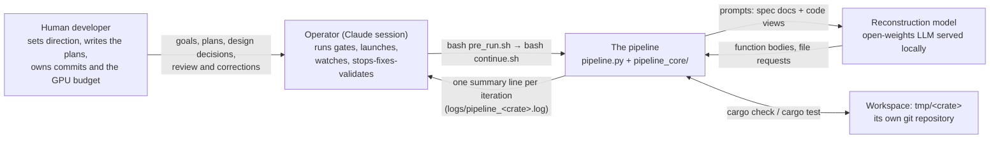
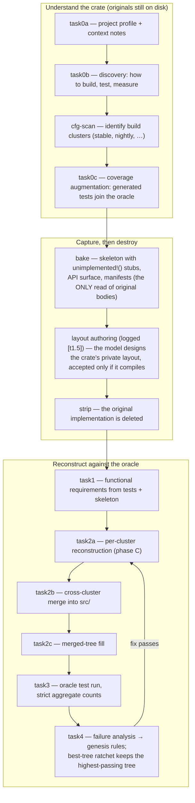
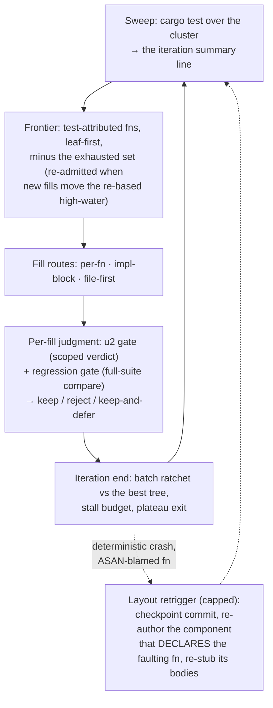

# Architecture — actors, phases, and contracts

This pipeline reconstructs a Rust crate's implementation from its own tests.
The crate's original bodies are deliberately destroyed early in the run; what
survives is the test suite (original tests plus generated ones) and a set of
baked artifacts — a stubbed skeleton, the public API surface, type manifests.
A locally served language model then re-fills the skeleton function by
function, and the test suite is the only judge of whether it succeeded.

This document records the things that change slowly: who the actors are, what
the phases do, and the contracts at each boundary. It deliberately does not
inventory modules — the package layout is enforced by a machine-checked
contract (see [Where truth lives](#where-truth-lives)), and per-file
descriptions rot faster than they help. Where a fact is likely to drift
(model names, budgets, counts), this document points at the file that owns it
instead of copying the value.

## The actors

**The human developer** is the system's author and director, not its
sign-off step. The plans originate here: the developer sets the goals,
writes the plan files, makes the architectural and design decisions
(which mechanism to build, which trade to accept, which debt item is worth
its cost), reviews the operator's work, and corrects its course
mid-session. The developer also owns every commit and allocates the GPU
budget the runs burn. Decisions and open questions flow through working
notes (`handover.md`, `technical_debt.md`, the plan files) that are
deliberately *not* tracked — they are conversation, not source.

**The operator** is a Claude session running this repository's operating
discipline (`CLAUDE.md`). It never edits the crate under reconstruction; it
edits the *pipeline*, and interacts with a live run through a deliberately
narrow interface: the gate scripts going in, and one log line per iteration
coming out. When a run goes wrong, the loop is stop → fix → re-gate →
relaunch, and pathological runs are distilled into replayable "walk" fixtures
so the expensive failure funds a cheap regression test.

**The pipeline** is `pipeline.py` (the composition root — wiring only) plus
the `pipeline_core` package, layered domain-first and enforced by
import-linter: `adapters` may import `application`, which may import
`prompts`, then `ports`, then `domain`, never the reverse. LLM providers,
git, cargo and the filesystem live in `adapters`; everything the pipeline
*decides* lives below them.

**The reconstruction model** is stateless. It has no memory between calls;
everything it knows arrives in the prompt — which is why the prompt-content
channels (below) are documented and test-pinned. It is the system's subject,
not its author: it fills bodies, requests files, and reports its own
confusions, but every verdict about its output comes from `cargo test`.

**Two artifact worlds, two git repositories.** This repository holds the
pipeline's source and gates. The workspace `tmp/<crate>` is a separate git
repository holding the crate under reconstruction, and its dot-directories
are *tracked there*: `.skeleton/<cluster>` (the authored stub layout),
`.skeleton-filled/<cluster>` (the tree cargo actually builds and scores —
after strip, the workspace's `src/` is a one-line shell), and
`.best_tree/<cluster>` (the durable highest-passing snapshot). A skeleton and
its filled tree only make sense as a pair from the same commit: the layout is
re-authored between runs, so bodies from one run do not compile against
another run's skeleton.

## The phases

Each phase's one-line description is maintained in
`pipeline_core/monitor/legend.py` (the monitor TUI shows it on `[l]`); this
section adds the shape of the whole and why the order is what it is.

Three properties of this order carry most of its meaning:

- **The oracle is fixed before anything is destroyed.** task0c grows the test
  suite while the real implementation still exists to test against; from
  strip onward the suite is frozen and every later phase answers to it.
- **Bake is the only read of original bodies.** Everything downstream sees
  tests plus baked artifacts. The layout-authoring step between bake and
  strip lets the model design the *private* layout (struct fields, vtables,
  helper signatures) it will later have to fill — an authored layout is
  accepted only if the skeleton still compiles with `unimplemented!()`
  bodies, and a component that won't compile keeps its frozen baked layout.
- **Clusters partition everything downstream.** cfg-scan turns feature/cfg/
  toolchain directives into build clusters (for anyhow: `stable`, `nightly`);
  reconstruction, merge and scoring are all per-cluster, and task2b re-unites
  the filled trees under cfg gates.

## Phase C — the reconstruction loop

task2a's phase C is where nearly all decision-making lives. The driver is
selected by `PHASE_C_DRIVER`; the default `tdd` driver
(`pipeline_core/application/reconstruct/phase_c_tdd.py`) runs an outer loop
whose whole state is printed as one line per iteration:

    [stable] [phase-c/tdd] iter N: cargo test rc=… pass=X fail=Y oracle=Z
        (improved=…, stall=a/b); frontier=F fn(s) (merged), E skipped as exhausted

That line is an API, not a convenience: the operator's monitor greps for it,
walk fixtures are distilled from it, and diagnosing a stalled run means
reading `frontier` and `exhausted` as a pair across iterations — the pass
count alone cannot distinguish "filling a producer chain that hasn't closed
yet" from "locked out of the only functions that matter".

**Fill routes.** One model call can target a single function, a whole impl
block (all members fixed together), or a whole file. Each spliced body passes
through a transactional splice and an inner compile-fix loop that re-prompts
with focused rustc errors before giving up and reverting.

**Judgment.** Two gates score a fill. The *u2 gate* runs the tests attributed
to the filled unit and issues a scoped verdict. The *regression gate*
compares full-suite readings, scoped to test binaries that completed in
*both* readings — a crashed binary emits a nondeterministic subset of
verdicts, so its counts are draws, not measurements. Both gates attribute
crashes before charging them: a panic that fires inside another unit's
still-hollow stub is the hollow tree speaking, and the fill is kept with its
scoring deferred rather than rejected for a sibling's emptiness. Anything
else — a segfault, an assertion failure, a real count drop — is charged to
the fill.

**Destruction on purpose.** Several mechanisms destroy progress
deliberately: the layout retrigger reverts a component's bodies to stubs
after a deterministic memory fault (blamed by an ASAN sweep, aimed at the
component that *declares* the faulting fn, never a name match), the batch
ratchet restores the best tree when a sweep regresses without excuse, and
skeleton-validate reverts implicated fns at cluster end. Every such
destruction invalidates the pass count for *every* consumer of it — so the
ratchet withholds charges during a refill window, the stall budget pauses,
and the re-admission high-water is re-based. The operating rule when adding
any new exemption of this kind is in `CLAUDE.md`: grep for every other
reader of the same quantity before shipping.

**Feedback stores.** A failed fix loop ends in a retrospective: the model
diagnoses its own failure class and the conviction is stored with guidance
for the next attempt. task4 distills run-level failures into `genesis.md`
rules that are injected into later prompts, and a periodic genesis audit
dedupes and drops stale rules. Convictions are claims about a moment — the
loop checks a conviction's stated premise against the current tree before
honouring it.

## Talking to the reconstruction model

Every call is self-contained; the model's entire world is the prompt. Four
channels compose it:

- **Spec documents** — the project profile, coverage strategy, functional
  requirements, genesis rules and API surface. Which documents reach which
  task's prompt, and the exact injection sites, is the matrix in
  `docs/PROMPT_CONTENT_AUDIT.md`, pinned executable by
  `tests/test_prompt_content_audit.py`.
- **Code views** — the skeleton scaffold, sibling context, type definitions.
  Structural facts (fn signatures, impl membership, dispatch families) come
  from the Rust-side extractor over the JSON seam documented in
  `docs/SEAM.md`, never from regex.
- **The pull protocol** — mid-task, the model may request material by
  emitting `<REQUEST kind="file" arg="src/error.rs"/>` (or `type_def`,
  and friends); the resolver answers within the prompt budget and the
  conversation continues.
- **Feedback** — prior attempts with their rustc errors, the model's own
  accumulated notes, retrospective guidance, and the "Confusions to Avoid"
  section it wrote into the functional requirements.

Replies are structured (tagged FN blocks), spliced transactionally, and
judged by cargo — the model asserts nothing the gates don't verify.

## Operating the pipeline

A run starts only after something has vouched for the code, in two stages:
`check.sh` (static gates, the pytest suite, coverage and LOC ratchets —
is the code correct), then the walks (`pytest -m walk` — does the loop's
decision sequence go where the theory says, replaying recorded pathological
runs through the real driver with cargo and the model stubbed). On a full
pass, `pre_run.sh` stamps a content hash of the decision-making tree
(`pipeline.py`, `pipeline_core`, `tools`, the extractor's Rust sources —
tests and docs are deliberately outside it), and `continue.sh` refuses to
launch when the stamp has moved. Git cannot play this role: runs launch from
an uncommitted tree.

While a run is live, the launcher wraps it in `lib/record_death.sh`, which
appends every process death (exit status, signal, log tail) to
`logs/deaths.jsonl`. The operator watches the iteration summary line plus a
tight set of terminal signatures; the monitor TUI (`pipeline_core/monitor/`)
renders the same event stream with the phase legend one keypress away. When
a run exhibits a pathology no walk covers, `tools/distill_walk.py` turns its
log into a fixture, and the fix that follows ships with a negative control:
the same walk run against the pre-fix code must reproduce the bad outcome,
or the test has proved nothing.

## Where truth lives

- Phase one-liners: `pipeline_core/monitor/legend.py` · log-field meanings:
  `pipeline_core/monitor/field_glossary.py`
- Layer contract: `[tool.importlinter]` in `pyproject.toml` (machine-checked
  by `check.sh`)
- Prompt-content matrix: `docs/PROMPT_CONTENT_AUDIT.md` (test-pinned)
- Python↔Rust extractor seam: `docs/SEAM.md`
- Model roster and capability map: `pipeline_core/adapters/llm_transports.py`
- Gate identity: `lib/tree_stamp.sh` · operating discipline and its case
  law: `CLAUDE.md`
